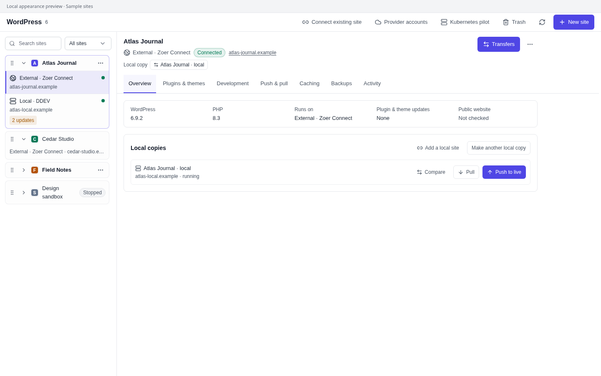
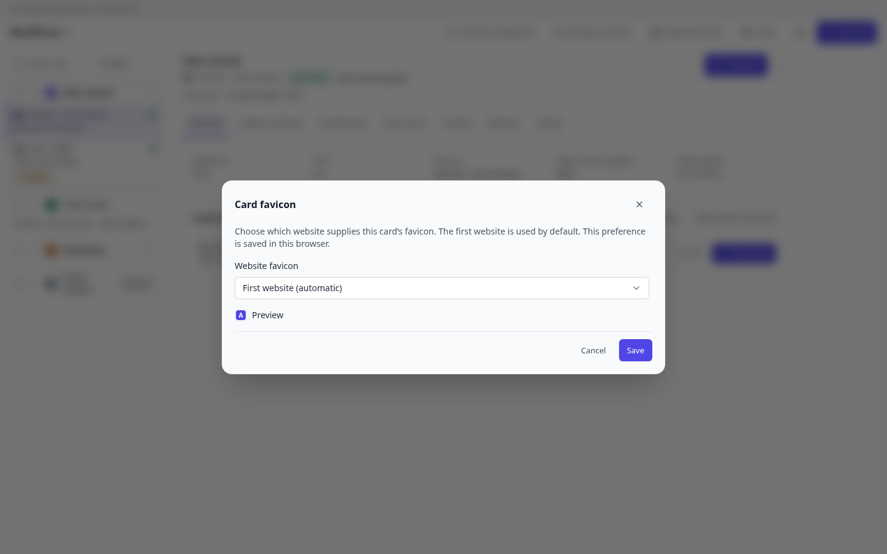
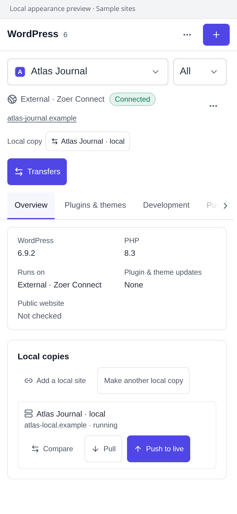
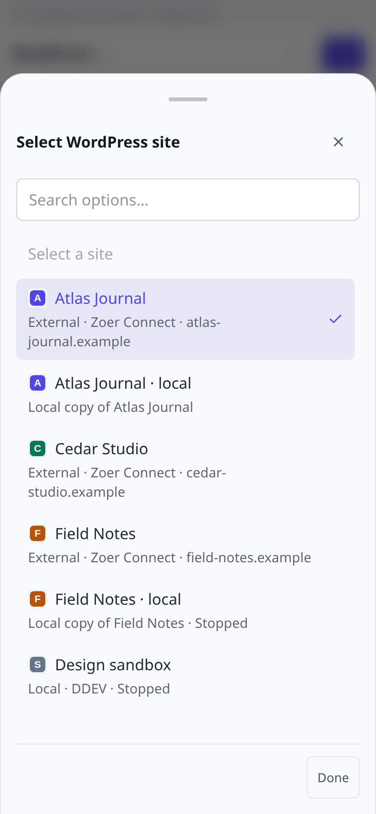

# Site card appearance previews

These screenshots render the updated WordPress Manager components with Zoer's shared controls. Sites, status values and favicon images are sample data supplied by an isolated local appearance fixture. They demonstrate the layout; they do not establish live site connectivity or hosting qualification.

The desktop viewport is 1440 × 900. The phone viewport is 390 × 844, captured with Chromium mobile emulation at a device scale factor of 2. The previews show the plugin workspace without the surrounding Zoer navigation shell.

- Desktop cards have drag handles and collapse buttons. Field Notes and Design sandbox are collapsed in the preview. Order and collapsed state are saved in this browser.
- A standalone card uses its website's favicon. A group defaults to its first website and offers **Choose card favicon** in its menu.
- The phone picker shows site favicons and follows the saved card order. Card dragging and collapsing are currently available in the desktop site list.

## Desktop

## Group favicon setting

## Mobile

| Overview | Site picker |
| --- | --- |
|  |  |

## Validation

The plugin's 474 tests, typecheck, build, package validation and release packaging passed. Component browser checks cover collapse/reload, retained form state, keyboard focus and movement, mouse dragging/reload, Escape cancellation, filtered ordering and touch-pointer handling. Run the browser check after building with `bun tests/site-cards.browser.ts`; `CHROMIUM_PATH` can select the local Chromium executable.

Website favicon retrieval also requires the matching Zoer host's site-authorized favicon service. That host change has its own linked pull request. The live Zoer instance was unreachable from this environment, so no deployment or live integration qualification is claimed.
